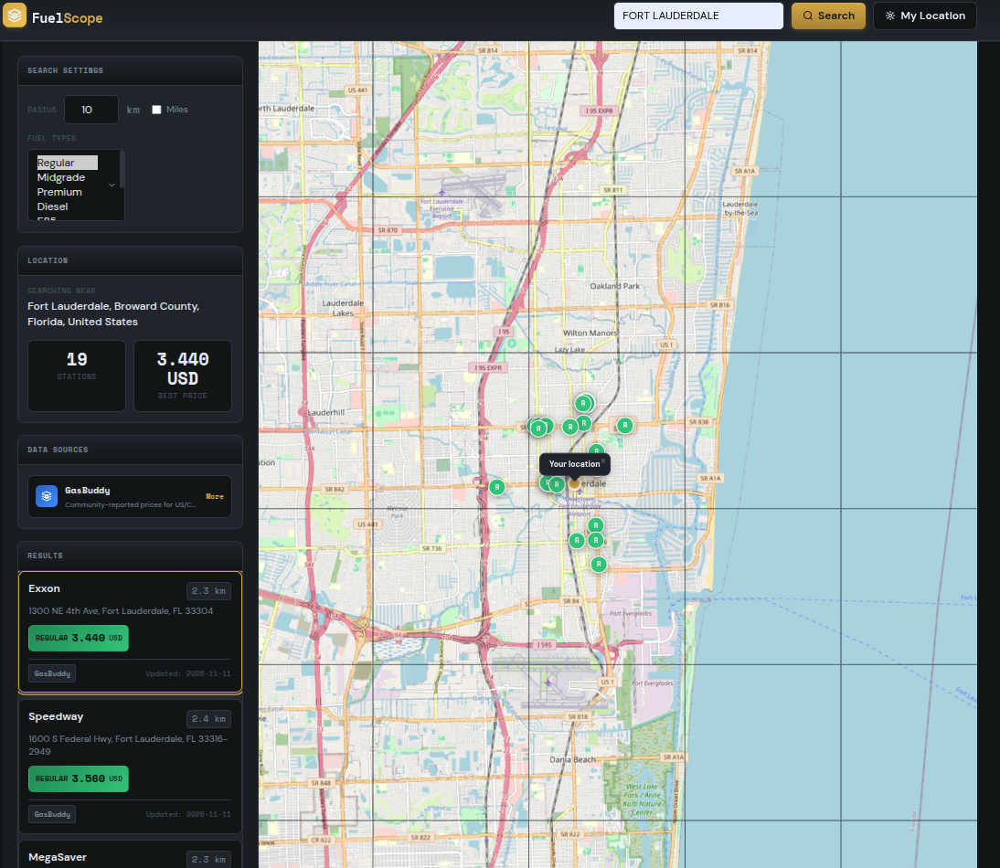

# FuelScope — Cheapest Fuel Finder

A CLI tool and web app to find the cheapest gas, diesel, E85, and alternative fuels near you. Uses **GasBuddy** (US/Canada), **FuelWide** (Europe/Australia), and **NREL AFDC** (station locations).

## Screenshots

### Web App (http://localhost:5002)


*Dark mode default with warm amber accent • Light mode supported • Reduced motion respected*

## Features

- **Location detection** — IP auto-detect, GPS, ZIP code, city name, or lat/lon
- **Fuel types** — Regular, Midgrade, Premium, Diesel, E85, E10, E5, LPG
- **Multi-source** — GasBuddy (community prices), FuelWide (gov open data), AFDC (canonical stations)
- **Interactive map** — Leaflet with color-coded markers, cross-highlight with list
- **Miles/Km toggle** — Live radius conversion with auto-re-search
- **E85 "Has Pump" badge** — Shows stations with E85 pumps but no price yet
- **Data source attribution** — Links to each provider
- **Caching** — GasBuddy responses cached locally (5 min TTL)

## Quick Start

### Prerequisites

- Python 3.10+
- Virtual environment (recommended)

### Installation

```bash
# Clone the repo
git clone https://github.com/bryce954/gas-finder.git
cd gas-finder

# Create and activate virtual environment
python3 -m venv gas_finder_venv
source gas_finder_venv/bin/activate  # or .\gas_finder_venv\Scripts\activate on Windows

# Install dependencies
pip install -r requirements.txt
```

### Dependencies

```txt
# requirements.txt
requests>=2.31.0
py-gasbuddy>=0.2.0
aiohttp>=3.9.0
pandas>=2.1.0
flask>=3.0.0
```

## Usage

### CLI Tool

```bash
# Auto-detect location, show cheapest regular gas
python gas_finder.py

# Specific location, diesel only
python gas_finder.py --location "Fort Pierce, FL" --fuel diesel --limit 5

# Coordinates, multiple fuel types, larger radius
python gas_finder.py --lat 27.45 --lon -80.33 --fuel regular --fuel diesel --radius 20

# JSON output for scripting
python gas_finder.py --location "34950, FL" --json

# Show all fuel types at a location
python gas_finder.py --location "90210" --fuel regular --fuel premium --fuel diesel --fuel e85
```

**CLI Options:**
| Flag | Description |
|------|-------------|
| `--lat`, `--lon` | Coordinates (decimal degrees) |
| `--location`, `-l` | ZIP code, city, or address |
| `--radius`, `-r` | Search radius in km (default: 10) |
| `--fuel`, `-f` | Fuel type filter (repeatable) |
| `--limit`, `-n` | Max results (default: 10) |
| `--json` | Output as JSON |

**Fuel type choices:** `regular`, `midgrade`, `premium`, `diesel`, `e85`, `e10`, `e5`, `lpg`

### Web App

```bash
# Start the server
python app.py

# Open in browser
open http://localhost:5002
```

**Web App Features:**
- Auto-search on input blur or Enter
- "My Location" button for GPS
- Miles/km toggle with automatic radius conversion
- Color-coded fuel badges (E85=blue, Diesel=red, Regular=green, etc.)
- Cross-highlight map↔list selection
- "Has pump" yellow badge for E85 stations with price=0
- Data sources panel with links to each provider

## Architecture

```
gas_finder.py          # Core logic: GasFinder class, FuelPrice dataclass
gas_finder_cache.py    # Local JSON cache for GasBuddy responses
app.py                 # Flask backend with /api/search, /api/geocode, /api/sources
templates/index.html   # FuelScope frontend (Leaflet + vanilla JS)
```

### Data Sources

| Source | Coverage | Fuel Types | Notes |
|--------|----------|------------|-------|
| **GasBuddy** | US, Canada | Regular, Midgrade, Premium, Diesel, E85 | Community-reported via `py-gasbuddy` |
| **FuelWide** | FR, IT, ES, AU | Diesel, Petrol95, Petrol98, LPG, E5, E10 | Official gov open data |
| **NREL AFDC** | US nationwide | E85, CNG, LNG, LPG, Electric, Hydrogen | Canonical station locations via ArcGIS FeatureServer fallback |

### GasBuddy Rate Limiting

The tool includes exponential backoff retry logic (5 attempts, 5/10/20/40/80s delays) and token cache clearing to handle Cloudflare protection.

## Development

### Project Structure

```
gas-finder/
├── app.py                 # Flask entry point
├── gas_finder.py          # Core finder logic (CLI + library)
├── gas_finder_cache.py    # Cache implementation
├── requirements.txt       # Python dependencies
├── templates/
│   └── index.html         # FuelScope frontend
└── .gitignore
```

### Running Tests

```bash
# Quick smoke test
python gas_finder.py --location "34950, FL" --json | jq .

# Test web API
curl -X POST http://localhost:5002/api/search \
  -H "Content-Type: application/json" \
  -d '{"location": "90210", "radius": 10, "fuel_types": ["regular"]}'
```

## Design System (FuelScope)

- **Typography:** Space Mono (monospace/data) + DM Sans (UI)
- **Palette:** Deep charcoal `#0a0d0f` + Warm amber `#d4a843`
- **Fuel Colors:** Semantic gradients per type (calibrated for dark/light)
- **Motion:** Staggered entrance, pulse glow, respects `prefers-reduced-motion`
- **Theming:** Full light mode via `prefers-color-scheme`

## Roadmap

### In Progress
- [ ] Add price history charts (visualize 7/30-day trends per station)
- [ ] Favorites / price drop alerts for saved stations
- [ ] Route planning: find cheapest fuel along a driving route

### Done
- [x] CLI tool with JSON/human-readable output
- [x] Web app with Leaflet map + miles/km toggle
- [x] Multi-source: GasBuddy, FuelWide, NREL AFDC
- [x] E85 "Has Pump" badge for stations with pumps but no price
- [x] Price history tracking with trend analysis
- [x] Price history charts (Chart.js line charts)
- [x] Map directions to stations (Google Maps, Apple Maps, Waze)
- [x] Favorites with price drop alerts
- [x] Route planning: find cheapest fuel along a driving route
- [x] GitHub Actions CI (lint, type-check, tests, Docker build)
- [x] Miles as default unit

### Future
- [ ] Expand FuelWide coverage to more countries
- [ ] Multi-point E85 search improvements
- [ ] Docker Compose for easy deployment
- [ ] Mobile app (React Native or Flutter)

## License

MIT — see [LICENSE](LICENSE) for details.

## Acknowledgments

- [GasBuddy](https://www.gasbuddy.com) for community price data
- [FuelWide](https://fuelwide.com) for European gov open data
- [NREL AFDC](https://afdc.energy.gov) for canonical station locations
- [py-gasbuddy](https://github.com/atomica/py-gasbuddy) Python wrapper
- [Leaflet](https://leafletjs.com) for the map
- [OpenStreetMap](https://www.openstreetmap.org) for map tiles